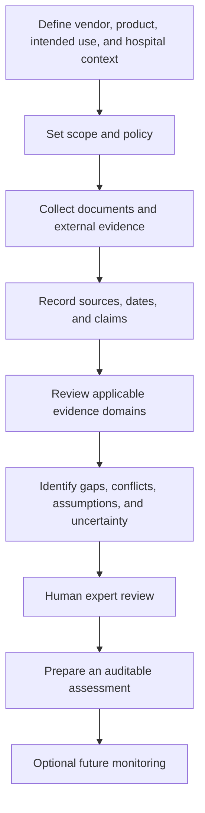
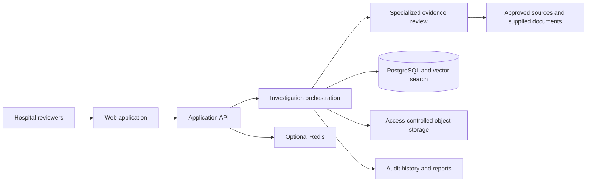

# Kyro

**Kyro is a proposed healthcare vendor intelligence platform for hospitals and healthcare organizations in India.** It aims to help procurement and technical teams organize evidence and assess healthcare technology vendors in their hospital-specific context.

> **Status:** Initial documentation only. Capabilities and architecture below are proposals, not implemented functionality. No regulatory approval, certification, hospital deployment, customer, commercial validation, or performance result is claimed.

## Overview

Healthcare vendor assessments may require evidence from regulatory sources, vendor documentation, certifications, research publications, security disclosures, and hospital-specific requirements. HealthVet aims to coordinate evidence collection and review, surface claims, gaps, and contradictions, and prepare an auditable assessment for human review.

## Problem statement

Hospitals evaluate regulatory applicability, security and privacy, clinical evidence, financial and operational risk, vendor documentation, and interoperability. Information can be scattered, incomplete, inconsistent, or outdated. Teams need a repeatable way to distinguish claims from evidence, track sources, and identify uncertainty and unanswered questions.

## Proposed solution

A future multi-investigator workflow would gather evidence for a defined vendor, product, intended use, and hospital context; retain source provenance; identify gaps and contradictions; and produce a reviewable report. It is decision support, not a replacement for qualified clinical, legal, security, procurement, or regulatory judgment. Requirements vary by product and context: CDSCO requirements may apply where relevant, and ABDM interoperability may matter for some integrations. Not all vendors have identical obligations.

## Core capabilities (planned)

- Vendor investigation and evidence review across relevant regulatory, security, privacy, clinical, financial, operational, and technical domains.
- Integration readiness review for applicable EMR, HMIS, PACS, LIS, APIs, and ABDM contexts.
- Source-linked assessment of claims, with evidence gaps, conflicts, uncertainty, and stale information highlighted.
- Auditable trust reports and hospital-specific evaluation policies.
- Potential monitoring of selected vendor sources over time.

These are proposed capabilities, not implemented or validated features.

## Intended users

Hospital procurement and vendor-management teams; IT, architecture, and integration teams; security and privacy professionals; clinical informatics and governance teams; compliance, legal, and risk stakeholders.

## High-level investigation workflow



## Proposed technical architecture

Conceptual only; no application or backend exists yet.



## Proposed technology stack

| Area | Proposed direction | Status |
| --- | --- | --- |
| Frontend | React, TypeScript, Vite, Tailwind CSS, React Router, Lucide React, Framer Motion | Proposed; not implemented |
| API | Python, FastAPI | Proposed; not implemented |
| Data | PostgreSQL, pgvector | Proposed; not implemented |
| Orchestration | Graph-based agent framework | Candidate; not selected |
| Supporting services | Redis, object storage | Optional; not implemented |

This is not an installed dependency or deployment manifest.

## Planned project structure

```text
HealthVet/
├── README.md
├── .gitignore
├── LICENSE                 # Licensing status; no license selected
└── docs/
    └── project-overview.md
```

## Development roadmap

1. Document scope, assumptions, and open questions.
2. Refine evaluation criteria, source governance, privacy, and security with stakeholders.
3. Design a narrow workflow and evaluate it with non-sensitive sample material.
4. Specify provenance, versioning, access, retention, audit history, and report traceability.
5. Validate technical choices for retrieval, orchestration, integrations, and deployment.
6. Implement and evaluate approved workflows with human review and failure handling.
7. Consider monitoring only after source coverage and alert review are defined.

Planning outline only; no schedule or completion is implied.

## Local setup

There is no runnable application at this documentation stage. To inspect the repository:

```bash
git clone https://github.com/sachdeva-aarushi/HealthVet.git
cd HealthVet
```

No application install or run commands exist yet. Proposed technologies are not dependencies.

## Security and privacy

Before real data is handled, define data minimization, purpose limitation, access controls and organization isolation, retention/deletion, encryption, secret handling, safe file processing, audit history, third-party review, and applicable legal obligations. Preserve evidence sources, dates, and limitations. Future AI processing must treat documents and web pages as untrusted data, expose uncertainty, and retain qualified human oversight. Do not submit patient or confidential hospital information to an unimplemented or unassessed system. This is not legal advice or a security certification.

## Current implementation status

Initial setup only: documentation and ignore rules. No frontend, backend, database, AI agent, integration, deployment, customer, hospital validation, or performance result is represented as available. Planned capabilities and technologies remain unimplemented.

## Limitations and future scope

Source coverage, accuracy, freshness, assessment methodology, scoring, and hospital policies are unvalidated. Regulatory applicability needs context-specific expert review. Automated analysis may be incomplete or wrong and requires source verification. Interoperability depends on the product and hospital environment. Continuous monitoring, enterprise integrations, and production operations are future possibilities only.

## Contribution guidelines

Documentation changes should state the need they address, distinguish facts from assumptions, avoid unsupported claims, exclude confidential or personal information, and receive relevant stakeholder review. Detailed code standards and review procedures will be written when implementation begins.

## License

No license has been selected. The repository is unlicensed; no permission to use, modify, or redistribute is granted. See [`LICENSE`](LICENSE) for the status note and consult the project owner before reusing material.
