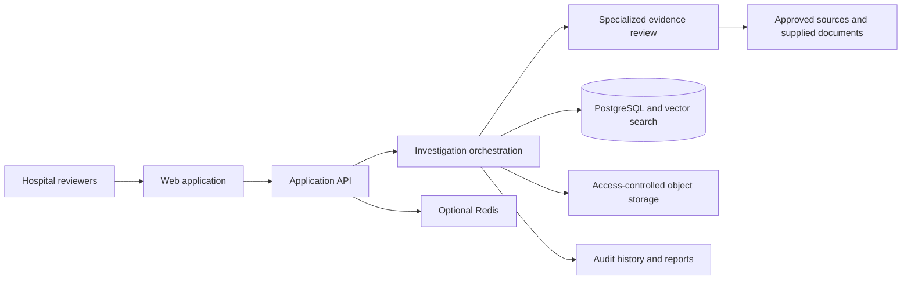

# HealthVet Project Overview

## Project motivation

Healthcare organizations evaluating technology vendors may need to review information spread across vendor documentation, regulatory sources, certifications, research publications, security disclosures, and internal technical requirements. HealthVet is proposed as a way to organize that work into a traceable, context-specific vendor assessment.

The intended market is India. Requirements depend on a vendor's product, intended use, data handled, deployment, and the adopting organization's context. CDSCO requirements may apply in some cases; ABDM interoperability may be relevant to some integration reviews. Neither should be assumed to apply identically to every vendor.

## Problem definition

Review teams need to assess regulatory applicability, security and privacy, clinical evidence, financial and operational risk, documentation, and interoperability. Inputs can be incomplete, inconsistent, or time-sensitive. Teams need a repeatable process to distinguish vendor claims from supporting evidence, identify missing information, and show how an assessment was reached.

HealthVet's proposed role is to support evidence collection and review, not replace expert judgment or issue regulatory, clinical, legal, or procurement decisions.

## Target users

- Hospital procurement and vendor-management teams.
- IT, enterprise architecture, and integration teams.
- Information security and privacy professionals.
- Clinical informatics and governance teams.
- Compliance, legal, and risk stakeholders.
- Healthcare organizations seeking a documented vendor evaluation process.

## Product objectives

1. Organize vendor claims and supporting evidence with traceable sources and dates.
2. Support reviews across relevant regulatory, security, privacy, clinical, financial, operational, and technical dimensions.
3. Highlight missing information, conflicting evidence, assumptions, and uncertainty.
4. Produce assessments that qualified reviewers can inspect, correct, and audit.
5. Allow evaluation criteria to reflect hospital-specific policies and product context.
6. Explore monitoring of selected evidence sources as a future capability.

These are objectives, not statements of implemented functionality or validated outcomes.

## Main workflows

### 1. Define an investigation

Identify the vendor and product, intended use, deployment context, data types, hospital environment, and review scope. Record which evaluation criteria apply and why.

### 2. Collect and organize evidence

Collect vendor-supplied documents and relevant external sources. Each item should retain its source, retrieval or publication date, associated claim, and review status. Source quality and limitations should be visible.

### 3. Assess evidence by domain

Review applicable domains only. These may include regulatory evidence (CDSCO where applicable), security and privacy against selected organizational criteria, clinical evidence and its limitations, financial and operational risks based on explicit assumptions, and technical integration readiness for the hospital context (EMR, HMIS, PACS, LIS, APIs, or ABDM where relevant).

### 4. Identify gaps and contradictions

Distinguish absent evidence from negative findings, compare claims with available sources, flag inconsistencies, and state uncertainty. Lack of evidence is not proof that a vendor meets or fails a requirement.

### 5. Review and report

Qualified people inspect evidence and analysis, request clarification, and record decisions. A report should link findings to sources, show outstanding questions, and preserve review history.

### 6. Consider ongoing monitoring (future)

If implemented, monitoring could track selected sources and provide reviewable change notices. Source availability, update frequency, and alert quality are not established.

## Functional requirements (proposed)

- Create an investigation with vendor, product, intended use, deployment, and organization context.
- Configure evaluation scope and hospital-specific criteria.
- Attach or reference documents and external evidence.
- Record source identity, dates, claims, evidence references, and reviewer notes.
- Classify findings by domain and distinguish claims, evidence, analysis, and decisions.
- Flag missing evidence, conflicts, stale sources, assumptions, and uncertainty.
- Support human review, correction, and documented disposition of findings.
- Generate reports with traceable evidence and investigation history.
- Consider alerts for selected sources in a future phase.

## Non-functional requirements (proposed)

- **Security:** Authentication, least-privilege access, secure file handling, protected secrets, and appropriate encryption.
- **Privacy:** Data minimization, purpose limitation, organization separation, retention and deletion controls, and review of applicable obligations.
- **Auditability:** Durable records of source versions, reviewer actions, changes, and report generation.
- **Reliability:** Clear handling of unavailable sources, partial results, failed processing, and stale evidence.
- **Transparency:** Expose provenance, limitations, uncertainty, and whether content is vendor-provided or independently sourced.
- **Usability:** Allow reviewers to inspect and correct generated outputs without losing the audit trail.
- **Maintainability:** Modular, documented architecture and tests for implemented behavior.
- **Interoperability:** Evaluate standards and interfaces against the specific product and hospital context.

These requirements need refinement and do not describe current system properties.

## Proposed architecture

Conceptual only. A future system may include a web interface, API, investigation orchestration, specialized evidence review, source connectors, relational and vector search, object storage, and audit/report services.

### Technology direction

Proposed frontend: React, TypeScript, Vite, Tailwind CSS, React Router, Lucide React, and Framer Motion. Proposed backend may use Python, FastAPI, PostgreSQL, pgvector, Redis, object storage, and a graph-based agent orchestration framework. These are candidates only; none is asserted to be installed or implemented.

## Security considerations

Before real information is handled, establish a threat model, data classification, allowed-use policy, access model, retention/deletion policy, audit requirements, and incident process. Consider encryption in transit and at rest, least privilege, organization isolation, secure secrets, upload scanning and validation, safe external-link handling, and review of third-party processors and data residency.

If AI processing is introduced, treat untrusted documents and web pages as data rather than instructions. Outputs should expose source provenance and uncertainty, be labeled as generated analysis, and receive human review before consequential use. Do not imply regulator approval, certification, or universal legal applicability. This is planning guidance, not certification or legal advice.

## Development phases

1. **Foundation:** Document goals, scope, risks, assumptions, and open questions.
2. **Requirements:** Refine user needs, criteria, governance, source policy, privacy, and security with stakeholders.
3. **Prototype design:** Select a narrow workflow and evaluate it with non-sensitive sample material.
4. **Evidence model:** Define provenance, versioning, review status, retention, access, and audit history.
5. **Technical validation:** Select tools and assess retrieval, orchestration, integration, and deployment options.
6. **Controlled implementation:** Build and test approved workflows, failure modes, and human review.
7. **Evaluation and future scope:** Assess reliability, usability, safety, and operations before wider integrations or monitoring.

No schedule, deployment, or completion claim is implied.

## Known limitations

- The repository is at an initial documentation stage; no product is implemented.
- No assessment framework, scoring method, source catalog, or regulatory mapping is validated.
- Source completeness, accuracy, and freshness are unknown.
- Regulatory applicability depends on context and requires qualified review.
- Automated analysis may be wrong or incomplete and cannot replace human judgment.
- Integration readiness is specific to the product and hospital environment.
- No clinical deployment, hospital adoption, commercial validation, certification, or performance results are claimed.
